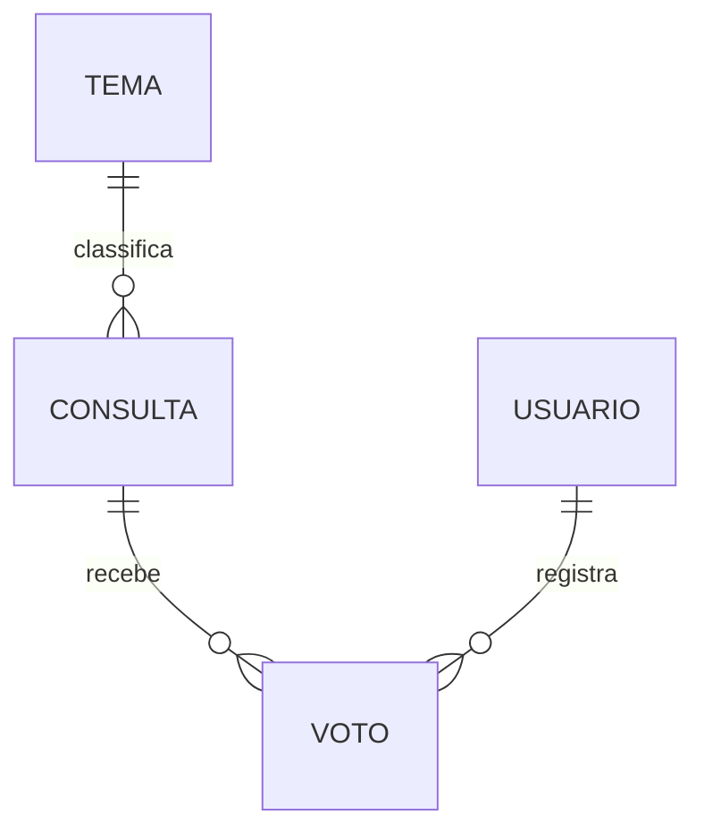

# Cidadão em Pauta

**Global Solution 2026/2 · CitizenTech · Java Advanced · 2TDSPB**

| Integrante | RM |
| --- | --- |
| Kayque Duarte | 567980 |
| Eric Maciel | 567398 |
| Gabriel Correa Souza | 567903 |


## A proposta

Moradores podem ter dificuldade para descobrir quais melhorias estão em discussão no bairro e como terminou cada consulta. A API organiza propostas por tema e bairro. Um gestor publica uma proposta como consulta, moradores autenticados votam e qualquer pessoa pode acompanhar a apuração depois do encerramento. Exemplo fictício: consultar o bairro sobre uma faixa elevada perto da escola.

A consulta é comunitária e consultiva. Um voto é único por **conta**, não por identidade civil verificada. O resultado mostra participação e distribuição de escolhas, não comprova a execução da melhoria nem representa toda a população. Para um piloto, o conselho de bairro ou a associação pode acompanhar quantidade de consultas encerradas, total de participações e tempo para divulgar a apuração.

## Rodar e testar

Requisitos: JDK 17 e Maven 3.9, ou Maven integrado ao IntelliJ. Abra a raiz que contém o `pom.xml`:

```bash
mvn clean verify
mvn spring-boot:run
```

No IntelliJ, importe o `pom.xml`, selecione o JDK 17, execute **Maven → Lifecycle → verify** e rode `Aplicacao.main`. A API escuta `127.0.0.1:8080` por padrão. Abra <http://127.0.0.1:8080/swagger-ui.html>. O perfil padrão `demo` usa H2 em memória com `create-drop`; o catálogo inicial é recriado a cada execução. Os votos têm persistência JPA durante a execução, mas o H2 demonstrativo não os mantém após reiniciar.

### Usuários fictícios (somente perfil demo)

| Papel | E-mail | Senha de demonstração |
| --- | --- | --- |
| GESTOR | `gestor@example.test` | `GestorDemo2026` |
| CIDADAO | `cidadao@example.test` | `CidadaoDemo2026` |

Em `POST /api/auth/login`, envie `{"email":"cidadao@example.test","senha":"CidadaoDemo2026"}`. Copie o valor de `token` para **Authorize** no Swagger. Em um cliente HTTP, use `Authorization: Bearer <token>`. O token expira em 30 minutos. O cadastro público sempre cria CIDADAO; o papel não é aceito no corpo. A senha fica como hash BCrypt, e o token é assinado e validado pelo Spring Security. O CORS aceita somente as origens de desenvolvimento configuradas em `CORS_ORIGINS`; Mobile nativo não depende de CORS, mas sua versão web depende.

### PostgreSQL persistente (alternativa ao perfil demo)

Copie `.env.example` para `.env`, configure `DB_PASSWORD` e um `JWT_SECRET` aleatório de pelo menos 32 bytes. Para provisionar o primeiro gestor, configure `GESTOR_INICIAL_EMAIL` e `GESTOR_INICIAL_SENHA` (10–24 caracteres); remova essas duas variáveis após o provisionamento. O perfil PostgreSQL não carrega usuários de demonstração. Não publique o `.env`.

```bash
docker compose up --build -d
docker compose logs api
```

O Flyway aplica a migration; o Hibernate roda com `validate`, sem alterar o schema. O volume do PostgreSQL preserva os registros. O Compose é para ambiente local, com API publicada no loopback. Para Mobile no Android Emulator, use `http://10.0.2.2:8080` quando acessível pela configuração do emulador; para dispositivo físico, configure o host e a rede do grupo. Para ambiente remoto, use HTTPS e configure as origens necessárias, sem publicar o perfil demo.

## Contrato para Mobile

| Rota | Acesso / resposta |
| --- | --- |
| `POST /api/auth/cadastro`, `POST /api/auth/login` | Público; conta 201 / token 200 |
| `GET /api/temas?busca=espacos&page=0&size=10&sort=nome,asc`, `GET /api/temas/{id}` | Público; lista paginada / detalhe |
| `POST /api/temas`, `PUT /api/temas/{id}`, `DELETE /api/temas/{id}` | Gestor; 201 / 200 / 204 |
| `GET /api/consultas?temaId=1&titulo=faixa&bairro=Bairro%20Modelo&estado=ABERTA&page=0&size=10&sort=criadaEm,desc` | Público; filtros combináveis e HAL paginado; rascunhos só aparecem ao gestor |
| `GET /api/consultas/{id}` | Detalhe com tema e ações; rascunho somente para gestor |
| `POST /api/consultas`, `PUT /api/consultas/{id}`, `DELETE /api/consultas/{id}` | Gestor; 201 / 200 / 204; alterações e exclusão só no rascunho |
| `PATCH /api/consultas/{id}/abrir`, `PATCH /api/consultas/{id}/encerrar` | Gestor; 200 |
| `POST /api/consultas/{id}/votos` com `{"escolha":"FAVOR"}` | Cidadão; recibo 201; também aceita CONTRA ou ABSTENCAO |
| `GET /api/consultas/{id}/resultado` | Público após encerramento; totais sem identidade dos votantes |
| `GET /actuator/health`, `GET /actuator/info`, `GET /actuator/metrics` | Health e info públicos; metrics requer token de gestor |

Corpo de tema: `{"nome":"Mobilidade"}`. Corpo de consulta: `{"titulo":"Faixa na escola","descricao":"Proposta de travessia segura","bairro":"Bairro Modelo","temaId":1}`. Consulte a lista para obter IDs. Use `_links` para navegação: `self`, `tema`, `consultas` e ações conforme papel e estado. Listas trazem `page` e `_embedded` quando há itens; páginas começam em 0, com no máximo 50 itens. Ações de escrita seguem os métodos da tabela, mesmo que tenham o mesmo endereço de um link de leitura.

Erros de domínio e entrada usam `status`, `mensagem`, `caminho` e `campos`: 400 (entrada), 401 (autenticação), 403 (papel), 404 (recurso ausente/invisível), 409 (duplicidade, vínculo ou estado). Para demonstrar: faça login como gestor, crie uma consulta, abra, troque para cidadão e vote, volte ao gestor para encerrar e consulte o resultado sem login.

## Modelagem, consultas e cache



| Entidade | Campos e restrições principais |
| --- | --- |
| `Tema` | id, nome, chave normalizada única (ignora caixa, acentos e espaços repetidos) |
| `Consulta` | id, título, descrição, bairro, estado, criação, FK tema |
| `Usuario` | id, nome, e-mail único, hash da senha, papel |
| `Voto` | id, escolha, data, FK consulta, FK usuário, único por par consulta + usuário |

As referências JPA são `ManyToOne LAZY`. DTOs são montados dentro da transação e nenhuma entidade é serializada. Não há cascata destrutiva: tema vinculado não pode ser excluído, e uma consulta publicada mantém seus votos. A escrita usa lock na consulta para que votação e encerramento não concorram sobre o mesmo estado; a unicidade do voto também é garantida no banco.

- **Query Method:** `findByChaveContaining` encontra temas pela chave normalizada com paginação; a consulta simples não precisa de JPQL manual.
- **JPQL:** `Votos.contar` agrupa por alternativa e conta no banco; a API não carrega ou divulga votos individuais para calcular totais.
- **Specification:** compõe título, tema, bairro, estado e visibilidade no mesmo filtro; paginação e ordenação vão ao banco. A lista de campos de ordenação é explícita.
- **Cache:** `@Cacheable` no detalhe de tema e na apuração encerrada, leituras reutilizadas pelo app. `@CacheEvict` invalida chaves afetadas após escritas bem-sucedidas; o gerenciador sincroniza com a transação. Busca paginada, autenticação e dados pessoais não são cacheados. O cache está em memória e é local a uma instância.

## Entrega Java

Para preservar os commits, use o arquivo Git bundle que acompanha o ZIP (o ZIP sozinho contém apenas os arquivos):

```bash
git clone CidadaoEmPauta.bundle CidadaoEmPauta
```

No clone, adicione o link real do vídeo ao README. Quando o repositório público do grupo estiver criado, aponte o remoto para ele antes de publicar. Se o repositório já tiver histórico, integre as mudanças sem sobrescrevê-lo.

As páginas 51–59 descrevem Java e pitch. O PDF de entrega pede um **arquivo TXT com apenas a URL pública do repositório da equipe** (p. 56). O projeto fica na raiz. Inclua o link do pitch aqui e também na área de Java Advanced indicada para o vídeo (p. 58). Confira ambos em janela anônima. O vídeo deve ter até cinco minutos. A apresentação presencial inclui demonstrar o app Mobile consumindo esta API e explicar os itens da p. 57. Este repositório fornece a API e o contrato; o app da equipe e a apresentação são etapas separadas. Consulte [conferência dos requisitos](docs/CONFERENCIA.md).
